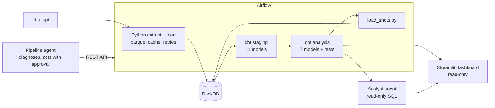
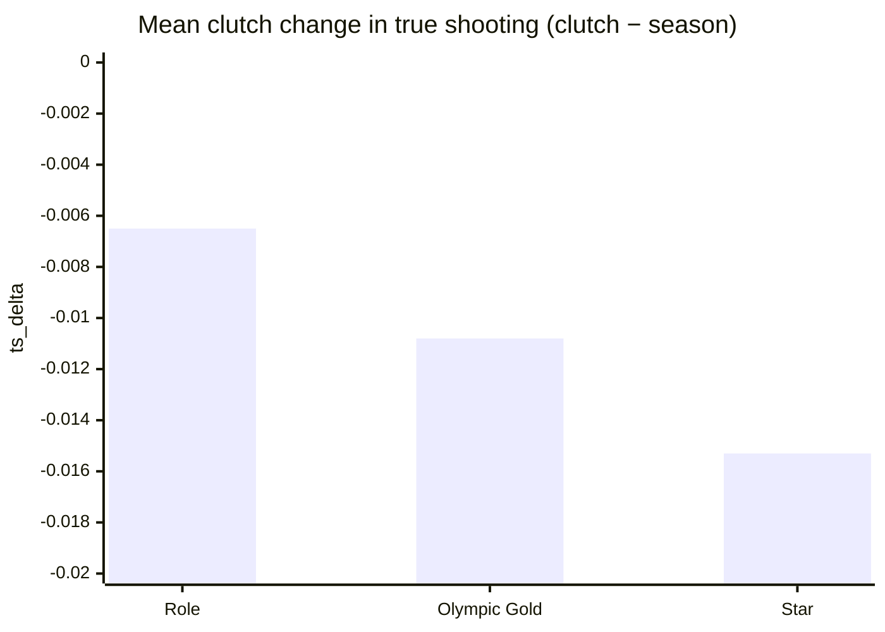
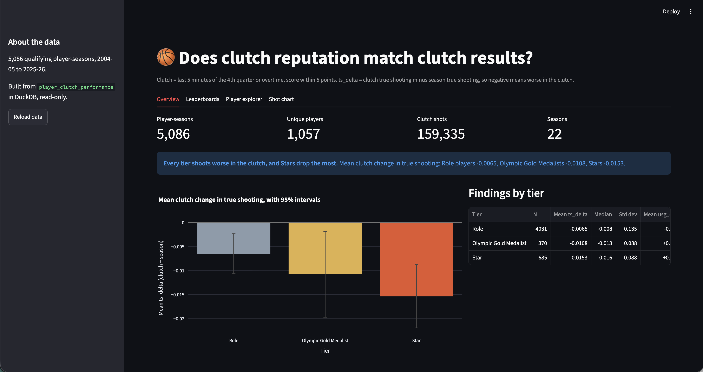
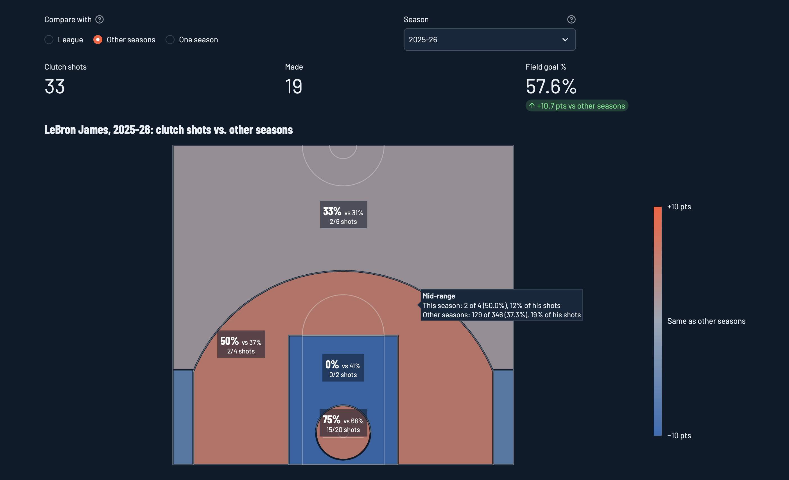
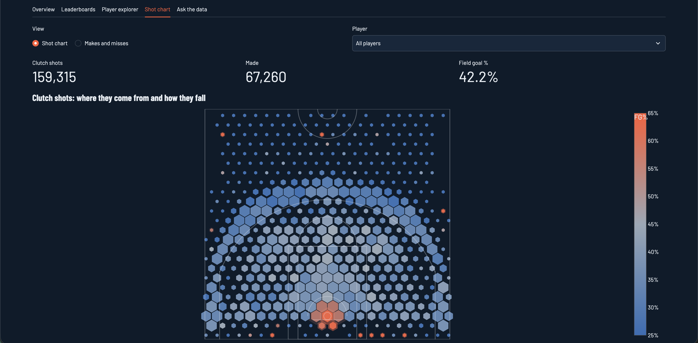
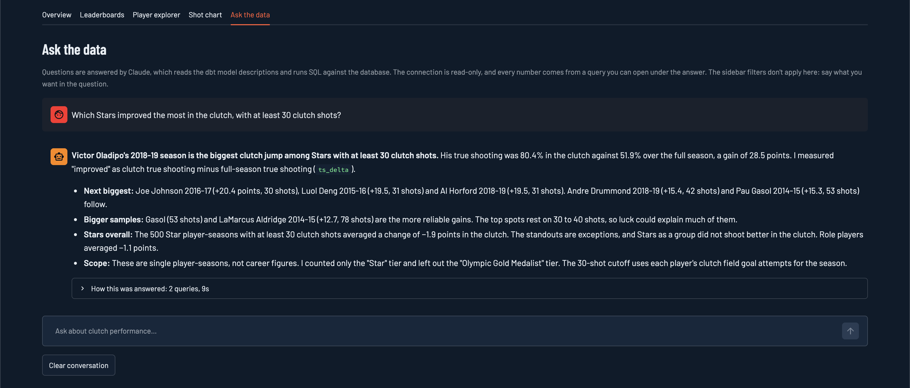
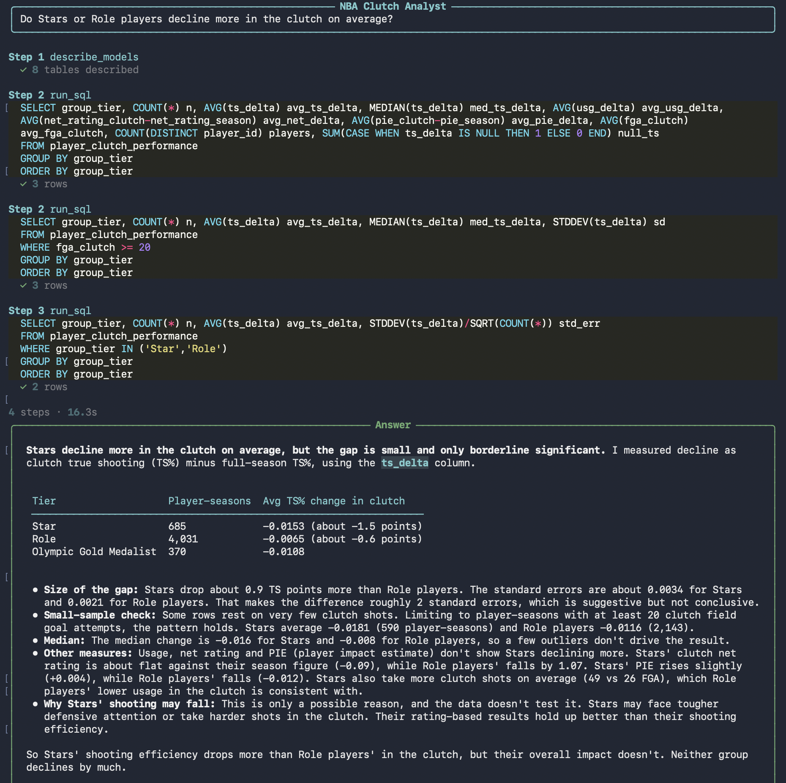

# 🏀 NBA Clutch Reputation Database


> [!IMPORTANT]
> **Stars decline the most in the clutch.** Across 5,086 player-seasons (2004-05 to 2025-26), every reputation tier shoots worse in the clutch than over the full season, and Stars drop the most: −1.5 points of true shooting vs. −0.65 for role players. Reputation gets them the ball, but it doesn't make the shots go in.

An ELT pipeline that extracts NBA player and team statistics via `nba_api`, loads them into DuckDB, and transforms them with dbt to analyze how players' clutch performance compares to their season-long performance and reputation tier — do "Stars" actually perform better in the clutch, or does reputation outpace results? Two Claude agents sit on top: an analyst that answers questions about the data in plain English with read-only SQL (in the terminal and in the dashboard), and a pipeline agent that diagnoses Airflow failures and acts only with your approval.

## Architecture



The pipeline follows a strict ELT pattern with three sequential stages:

1. **Extract + Load** (`pipeline/main.py`) — pulls raw data from 8 `nba_api` endpoints across every season from 2004-05 to the current one (worked out from today's date), caches responses as parquet, and loads them into DuckDB as raw tables. Loads are incremental: each season table replaces only the seasons fetched this run, or missing from the table (see [Live Data and Environments](#live-data-and-environments)). Failed API calls are retried with exponential backoff; anything still failing is written to a manifest in `pipeline/cached_data/failures/` and the run exits with an error, so incomplete data (like a player missing their awards, which would wrongly classify them as Role) never reaches dbt. Successful calls stay cached, so a rerun only re-fetches what failed.
2. **Transform** (`dbt build --exclude tag:shots`) — builds the staging layer and analysis models, and runs all data and unit tests, entirely in SQL. Shot models and their tests are tagged `shots` and skipped here, because the shots haven't been loaded yet.
3. **Shot extraction** (`pipeline/load_shots.py`, then a full `dbt build`) — pulls clutch shot-chart data, scoped to the ~5,086 player-seasons already qualifying in the `player_clutch_performance` dbt model (rather than every player-season in NBA history). Because this step queries a dbt model, it must run *after* stage 2, not alongside stage 1 — this is why it's a separate script rather than folded into `main.py`. A final full `dbt build` then builds and tests the shot models on the freshly loaded shots.

Raw tables store true, unrenamed API field names; a dedicated dbt staging layer (`models/staging/`) handles all renaming to friendly, analysis-ready column names — this logic previously lived in Python's load step and was moved into dbt so naming conventions are version-controlled, testable, and visible in the lineage graph.

All three stages are orchestrated by two Airflow DAGs, running in a local Docker Compose environment (CeleryExecutor, Postgres, Redis): `nba_clutch_pipeline` handles stages 1–2, then triggers `nba_clutch_shots` for stage 3 and the final dbt rebuild.

## Data Sources

All data comes from the unofficial `nba_api` Python package, covering Regular Season data from the 2004-05 season through 2025-26:

| Endpoint | Data |
|---|---|
| `LeagueDashPlayerStats` (Advanced) | Season-long advanced stats (ratings, efficiency, usage) |
| `LeagueDashPlayerStats` (Base) | Season-long basic box score stats |
| `LeagueDashPlayerClutch` (Advanced) | Clutch-situation advanced stats |
| `LeagueDashPlayerClutch` (Home/Road splits) | Clutch stats split by home vs. road games |
| `LeagueDashTeamStats` (Advanced) | Team defensive ratings, by season |
| Matchup/primary defender endpoints | Player-vs-player defensive matchup minutes |
| Awards endpoint | Career awards (used to classify reputation tier) |
| `ShotChartDetail` | Individual clutch shot attempts (official clutch definition), with location and opponent context |

## Repository Structure

```
data_eng_project/
    .github/workflows/
        dbt-ci.yml       — GitHub Actions: runs the dbt tests and the agent guardrail tests on every pull request
    pipeline/
        extract/         — one module per data domain (stats, matchups, awards, shots, static)
            api.py       — shared retry-with-backoff and failure-manifest helpers
        load/            — save/load utilities, missing-player backfill logic
        main.py          — orchestrates the full raw EL run
        load_shots.py    — separate script for shot extraction (see Architecture)
        checks.py        — data validation helpers
        cached_data/     — per-call parquet cache, avoids re-hitting the API on reruns (gitignored)
    dbt/
        models/
            staging/     — 11 staging models, renaming raw columns to friendly names
            7 analysis models + team_abv_lookup
            sources.yml, schema.yml (data tests & descriptions), unit_tests.yml
        dbt_project.yml
        tests/           — singular data tests (e.g. shot counts vs. official clutch FGA)
    agent/
        analyst.py           — analyst agent: answers questions with read-only SQL (see Analyst Agent)
        eval_cases.py        — eval questions and the checks each answer must pass
        run_evals.py         — runs the analyst on every eval case and scores the answers
        pipeline_agent.py    — pipeline agent: diagnoses Airflow runs, acts only with approval (see Pipeline Agent)
        reports/             — failure reports written by the Airflow callback (gitignored)
        pipeline_audit.jsonl — every action the pipeline agent proposed and took (gitignored)
        ask_log.jsonl        — every question asked in the dashboard's chat, with how it ended (gitignored)
    tests/
        test_pipeline_agent.py — automated tests for the pipeline agent's guardrails, against a fake Airflow
    dashboard/
        app.py           — Streamlit dashboard: overview, leaderboards, player explorer, shot chart, Ask the data, guide
        court.py         — draws an NBA half-court in nba_api's shot coordinates
        hexbin.py        — hexbin shot chart, with the glowing hot zones
        zones.py         — zone shot chart for comparing one player's seasons, with animated zones
        guide.py         — glossary, the Overview's "Explain this page" notes, chart hints and the Guide tab
        style.py         — colours, chart template and the scoreboard strip
    .streamlit/
        config.toml      — the dashboard's theme (fonts, colours)
    airflow/
        dags/
            nba_pipeline.py        — extract, dbt build, then triggers the shots DAG
            nba_shots_pipeline.py  — shot extraction and the full dbt build
            agent_callbacks.py     — on any task failure, runs the pipeline agent and saves a report
        Dockerfile                    — custom Airflow image with project dependencies
        requirements-dbt.txt          — dbt packages, installed into a separate venv in the image
        requirements.txt              — pipeline packages, installed with Airflow's constraints file
        .env.example                  — template for required secrets (copy to .env)
        docker-compose.yaml
    docs/
        agent-demo.png            — screenshot of the analyst agent
        dashboard-overview.png    — screenshot of the dashboard's overview tab
        dashboard-shot-chart.png  — screenshot of the clutch shot heatmap
        ask-the-data.png          — screenshot of the dashboard's Ask the data tab
    scratch/
        nba_data_load.ipynb              — ad-hoc notebook for testing snippets
        findings_ts_delta_by_tier.sql    — query behind the Findings section below
    setup.sh             — one-command dependency install (Python + dbt packages)
    requirements.txt     — pinned Python dependencies
    nba_schema.sql       — full raw table DDL (idempotent, run on every main.py run)
    nba_clutch.duckdb    — the database itself, created by the pipeline (gitignored)
```

## Setup & Running

**Requirements:** Python 3.13, Docker Desktop (for Airflow). Python dependencies are pinned in `requirements.txt`. Both agents also need an Anthropic API key (see Analyst Agent and Pipeline Agent).

**Install dependencies:**
```bash
./setup.sh                   # creates .venv if no environment is active, installs Python + dbt packages
source .venv/bin/activate    # skip if you're using your own conda/venv
```

> [!TIP]
> **macOS + python.org Python:** if setup fails with `CERTIFICATE_VERIFY_FAILED`, run `"/Applications/Python 3.13/Install Certificates.command"` once, then rerun `./setup.sh`.

> [!NOTE]
> The database and parquet cache aren't in the repo, so a fresh clone must run the full pipeline once: about 51 minutes for `main.py` and 2h39m for `load_shots.py` (roughly 3.5 hours total), since every season is pulled from the API. Runtimes vary with NBA API responsiveness. Later runs read from the local cache and are much faster.

**Run manually**, in this exact order (each stage depends on the previous one completing):
```bash
python3 -u pipeline/main.py                                  # raw extract + load — ~51 min on a fresh run (empty cache)
cd dbt && dbt build --exclude tag:shots --profiles-dir .     # builds and tests everything except the shot models
cd .. && python3 -u pipeline/load_shots.py                   # shot extraction — ~2h39m on a fresh run; requires the build above
cd dbt && dbt build --profiles-dir . && cd ..                # full rebuild so shot models and their tests run on the loaded shots
```

**Run via Airflow** (recommended — handles the sequencing automatically):
```bash
cd airflow
cp .env.example .env              # then fill in AIRFLOW_UID and generate the three keys (commands are in the file)
docker compose build              # builds the custom image with project dependencies
docker compose up airflow-init    # one-time setup
docker compose up -d              # starts the full stack
```
Then trigger the `nba_clutch_pipeline` DAG from the UI at `localhost:8080` (default login: `airflow` / `airflow`). The pipeline is split into two DAGs. `nba_clutch_pipeline` runs `main.py → dbt deps → dbt build --exclude tag:shots`, then triggers `nba_clutch_shots`, which runs `load_shots.py → dbt build` so shot models are rebuilt and tested on the freshly loaded shots.

<details>
<summary><b>Why a custom Airflow image and a separate dbt venv?</b></summary>

Airflow runs on a custom image (`airflow/Dockerfile`). Pipeline packages (`airflow/requirements.txt`) are installed with Airflow's official constraints file, so they can't shift Airflow's own tested dependencies. dbt is installed in a separate virtual environment (`airflow/requirements-dbt.txt`, at `/home/airflow/dbt_venv`) because its dependencies conflict with Airflow's (for example, dbt-core requires `pathspec<1.1` while Airflow pins 1.1.1); the DAGs call dbt by that path. Versions are pinned identically to the root `requirements.txt`, so local and Airflow runs use the same code, with one exception: pyarrow isn't listed in `airflow/requirements.txt`, so Airflow's constraints file sets it (25.0.0). The root file pins 25.0.1 because Streamlit, used only by the local dashboard, excludes 25.0.0. `anthropic` is also in `airflow/requirements.txt`, so the failure callback can run the pipeline agent inside the containers; `rich` isn't, because Airflow already pins it (14.3.4) and a second pin would conflict.

</details>

## dbt Models

A staging layer (11 models, one per raw table) handles all column renaming; the models below build on top of it via `ref()` rather than querying raw sources directly.

| Model | What it answers |
|---|---|
| `player_tier` | Classifies each player-season into a reputation tier — Role, Star, or Olympic Gold Medalist — using only awards won before that season |
| `player_clutch_performance` | One row per player-season with more than 100 season FGA and at least 15 clutch games, combining season-long and clutch stats, with `ts_delta` (clutch minus season true shooting) measuring the clutch change |
| `home_vs_road` | Compares clutch performance at home vs. on the road |
| `matchup_analysis` | One row per offensive player, defender, and season (2017-18 onward), with how long the defender guarded him (`matchup_minutes` in decimal minutes for math, `matchup_time` as mm:ss for display), the defender's own season defensive rating, and the offensive player's clutch `ts_delta` |
| `star_player_performance` | Subset of `player_clutch_performance` limited to Star/Olympic tier players, with each player's first award-winning season attached |
| `player_clutch_playmaking` | Adds season-long assist/rebound involvement alongside clutch scoring metrics |
| `shots_with_opponent` | Every clutch shot attempt joined to the shooter's opponent team and that opponent's season defensive rating |
| `team_abv_lookup` | Maps every team abbreviation used in any season, including historical ones (SEA, NJN, NOH, NOK), to its franchise `team_id` |

All models are tested for row-level uniqueness (via `dbt_utils.unique_combination_of_columns` or `unique`/`not_null` on a surrogate key) and, where relevant, accepted-value constraints on categorical fields. `stg_clutch_shots` is tested on its natural key (`game_id` + `game_event_id`) rather than only its sequence-generated `shot_id`, and `shots_with_opponent` is tested with `dbt_utils.equal_rowcount` against `stg_clutch_shots` to catch shots silently dropped by joins. A singular test (`tests/assert_shot_counts_match_clutch_fga.sql`) checks that each player-season's clutch shot count matches its official clutch field-goal attempts, so the shot and stats datasets can't drift onto different clutch definitions.

`player_tier`'s classification logic is covered by dbt unit tests (`unit_tests.yml`) using mocked award data. They check that an award only counts from the following season (no look-ahead), that a gold medal without a star-level NBA award stays Role since the tier reflects NBA recognition specifically, and that players with no awards are kept rather than dropped by the joins.

Model and column descriptions in `schema.yml` state each model's grain and the direction of every delta column. They're written for human readers and are also what the analyst agent reads to understand the data.

<details>
<summary><b>Materialization strategy: why one table and the rest views</b></summary>

All models build as views by default (set in `dbt_project.yml`). The one exception is `player_clutch_performance`, materialized as a table via a per-model `{{ config(materialized='table') }}` override, because it's referenced by `ref()` in five other models — `home_vs_road`, `matchup_analysis`, `player_clutch_playmaking`, `shots_with_opponent`, and `star_player_performance` — each of which would otherwise re-run its full join (season stats + clutch stats + `player_tier` + player names) independently on every build. Materializing it once means that join runs a single time and gets read, not recomputed, by each downstream model.

Staging models also have multiple consumers, but they're simple column-renaming selects, cheap enough to stay views. No other model combines an expensive join with multiple downstream consumers, so the rest stay views. The dashboard didn't change that: it reads each model once per session and caches the result, so views are queried rarely enough that materializing them wouldn't help.

</details>

## Continuous Integration

Every pull request into `main` runs `.github/workflows/dbt-ci.yml` on a fresh GitHub runner. It installs the pinned `requirements.txt`, creates an empty DuckDB database from `nba_schema.sql`, runs `dbt run --empty` to build every model with zero rows, then runs `dbt test`.

The real database isn't in the repo and takes about 3.5 hours to build from the API, so CI checks the code rather than the data: every model's SQL has to run against the actual raw schema, every `ref` has to resolve, and the `player_tier` unit tests run for real on their mocked data. Data tests like `unique` and `not_null` pass trivially on empty tables, so data quality is still checked by the full local build. `equal_rowcount` is skipped in CI because the dbt_utils macro returns NULL instead of 0 on empty tables.

The same workflow runs `pytest tests/`: 15 tests for the pipeline agent's guardrails against a fake Airflow server, covering approval, every refusal (active run, paused DAG, retry limit, unknown DAG), the audit log, the JSON log format, and diagnose-only mode. They check the code's rules, not the model's judgment, so they need no API key and run in seconds. Run them locally with `pytest tests/ -q`; one was verified by raising the retry limit on purpose and watching it fail.

## Findings: Does Clutch Reputation Match Clutch Results?

Using `player_clutch_performance` (see `group_tier` and `ts_delta` definitions
in the dbt Models table above), player-seasons were grouped by tier to compare
clutch vs. season shooting efficiency. The unit of analysis is the
player-*season*, not the unique player — a player appearing in 8 seasons
contributes 8 rows to their tier's numbers. Tiers only count awards won
*before* a given season, so a player's early seasons count as Role until he
has actually earned the reputation. Query: `scratch/findings_ts_delta_by_tier.sql`.



| Tier                  | N (player-seasons) | Mean ts_delta | Median ts_delta | Stddev ts_delta | Mean usg_delta |
|-----------------------|-------------------:|--------------:|----------------:|----------------:|---------------:|
| Role                  | 4,031              | -0.0065       | -0.008          | 0.135           | -0.0242        |
| Star                  | 685                | -0.0153       | -0.016          | 0.088           | +0.0019        |
| Olympic Gold Medalist | 370                | -0.0108       | -0.013          | 0.088           | +0.0136        |

**All three tiers decline in the clutch** — no group shoots better than its own
season average. There's no evidence here of a "clutch gene" that lifts
efficiency above baseline.

**Reputation doesn't protect clutch efficiency — Stars decline the most.** By
both mean and median, Stars show the largest drop (-0.015 / -0.016) and Role
players the smallest (-0.0065 / -0.008), with Olympic Gold Medalists in
between. The Star–Role gap is about 2.2 standard errors, suggestive rather than
conclusive; the Star–Olympic gap is well within noise.

**Usage tells the "how."** Role players' smaller drop comes with a real usage
pullback (-0.024): they take on less of the offense in the clutch. Stars keep
slightly *more* of the load (+0.002), and their efficiency falls the most —
reputation gets them the ball, but doesn't make the shots go in. Olympic Gold
Medalists increase usage the most (+0.014) while declining less than Stars.

**Removing look-ahead strengthened the result.** An earlier version labeled
every season of a player's career by his career awards, so 497 seasons from
before players earned their reputation were counted as Star or Olympic. With
those moved to Role, the Star decline grew from -0.0133 to -0.0153 (mean) and
the ranking became consistent across mean and median.

> [!NOTE]
> **Caveats:** clutch samples are smaller than season samples by construction (15+ clutch games vs. more than 100 season field-goal attempts), so individual player-season values are noisy — part of why Role's spread (0.135) is much wider than Star's (0.088). Player-seasons also aren't independent, since the same player appears in many seasons, so the standard errors above are likely optimistic.

## Dashboard



`dashboard/app.py` is a Streamlit app that turns the findings into something you can explore. Run it from the project root once the pipeline has built the database:

```bash
streamlit run dashboard/app.py
```

It opens at `localhost:8501` with six tabs. The sidebar filters (seasons, tiers, minimum clutch shot attempts) apply to every tab except Player explorer and Ask the data, so the dashboard always describes the same player-seasons.

- **Overview:** the headline finding computed live: mean `ts_delta` by tier with 95% intervals, the Findings table, the usage change, and a season-by-season trend. An **Explain this page** switch puts each part of the page in a numbered box with a short note on how to read it, built from the numbers currently on screen. For example, it states how many standard errors separate the tiers and what that means, so the notes stay correct when the filters change.
- **Leaderboards:** the biggest clutch declines and improvements. A scatter of `ts_delta` against clutch attempts shows why the minimum clutch shot attempts filter matters: small samples spread far from zero, and the spread narrows as attempts grow.
- **Player explorer:** one player's full-season and clutch true shooting across their career, with each season coloured by tier, so you can see the season a player's reputation starts.
- **Shot chart:** all 159,315 located clutch shots on a half-court as a hexbin chart. Hexagon size shows how many shots came from a spot, colour shows FG% against every clutch shot from the same spot, and the hottest zones glow. Spots with few shots are pulled toward the league average, so one lucky make can't paint a hot zone. A second view shows individual makes and misses.
- **Comparing a player's seasons:** with one player picked, *Compare with* sets the baseline: the league, all of his other seasons, or one other season. One season has only a few clutch shots per hexagon, so season comparisons switch to five court zones (restricted area, paint, mid-range, corner three, above-the-break three), drawn from the same lines as the court. Each zone shows both field goal percentages and this season's makes and attempts, and a table adds each zone's share of his shots. The same adjustment applies: a zone with few shots is pulled toward the comparison, and the comparison toward the league. Where he took no shots in the comparison, the league's FG% from that zone stands in, and the hover says so.


  
- **Ask the data:** a chat with the analyst agent, with the SQL behind every answer (see [Ask the Data](#ask-the-data-the-analyst-in-the-dashboard)).
- **Guide:** what the dashboard asks, what each filter does and when to use it, what each tab shows, and a glossary (true shooting, `ts_delta`, usage, tiers, mean vs. median, error bars, and more). The sidebar's *How to read this* shows the key terms from the same glossary in `dashboard/guide.py`, so a definition is written once and can't drift between places.



**Help where it's needed.** Every filter and control has a tooltip. Charts that can be zoomed carry a hint above them: drag to zoom, double-click to zoom back out, click a legend entry to hide it, double-click to show only that one. Plotly's own tip only appears once per session. The shot charts can't be zoomed, so the court always shows the full half court.

**Performance.** The app reads DuckDB with a read-only connection and caches each query, so the database is read once per session and every filter runs in memory. Player-seasons (about 5,000 rows) and shots (about 160,000) are small enough to load whole; at a larger scale, the filtering would move into SQL. A few changes keep the shot chart quick:

- **Only the shot tab reruns.** The tab is a Streamlit fragment, so changing a player or season reruns that tab instead of the whole page.
- **League numbers are computed once.** The league's zone numbers are cached.
- **Smaller charting library.** The animated shot charts are small standalone pages that load Plotly's basic build (about 1.2 MB instead of 4.6 MB), pinned to the version of the installed `plotly` package.
- **Charts wait until visible.** A chart built inside a hidden tab gets its text measured as zero size, which misplaced labels. So each shot chart draws once its tab is actually on screen, and its colour bar carries its labels in the tick text rather than a title.

The **Reload data** button in the sidebar clears the cache after a new pipeline run. Like the agent, the dashboard can't open the database while the pipeline or a dbt build is writing to it, and it shows a message instead of crashing.

## Ask the Data: the Analyst in the Dashboard



The dashboard's **Ask the data** tab puts the analyst agent behind a chat window, so anyone can ask questions about the data without a terminal or SQL. Type a question, or click one of the example questions when the chat is empty.

- **Live progress.** While the agent works, a status box shows each step as it happens (reading the table descriptions, running a query, retrying a failed query), then collapses to a summary like "Answered in 3 steps, 14s".
- **The evidence under every answer.** A "How this was answered" expander lists every SQL query the agent ran, so any number can be checked. Queries that failed and were corrected are marked.
- **Follow-up questions.** The last few messages go along with each new question, so "now only Stars" or "and in 2015-16?" keep the context.
- **Short answers.** The agent gets an extra instruction in the dashboard: lead with the direct answer, add a few supporting numbers and caveats, and leave the SQL to the expander.
- **Limits for public use.** Questions are capped at 500 characters and each browser session at 20 questions, which keeps API costs bounded. Without `ANTHROPIC_API_KEY`, the tab shows how to turn it on instead of failing.
- **A question log.** Every question is appended to `agent/ask_log.jsonl` (gitignored) with its stop reason, step count, queries and failed queries. Answers that ended incomplete or needed corrected queries are candidates for new eval cases. Logging can never break the chat: if the file can't be written, the question is still answered.

**Running it.** Set the key in the same terminal before starting the dashboard, since Streamlit only sees variables that exist when it starts:

```bash
read -s "ANTHROPIC_API_KEY?Paste key: "
export ANTHROPIC_API_KEY
streamlit run dashboard/app.py
```

**How it works.** The tab calls the same `ask()` function as the terminal agent, with three optional arguments: `on_step`, a callback that updates the progress box instead of printing to the terminal; `history`, the earlier messages; and `extra_instructions`, the dashboard's answer style. The agent doesn't know where it's being displayed, so the guardrails, evals and model descriptions all carry over unchanged.

**Safety.** Visitors can type anything, including attempts to make the agent change data. The guardrails sit in the database connection, not the prompt: it's read-only, has no file or network access, and runs nothing but a single `SELECT`. So a hostile question gets a refusal or a harmless query, never a write. The dashboard's own charts use the same locked-down connection, which also lets both open the database at the same time.

## Analyst Agent



`agent/analyst.py` answers questions about the data in plain English. It's a Claude model running in a loop with two tools: `describe_models`, which reads each analysis model's description and column descriptions from dbt's manifest along with the column types from DuckDB, and `run_sql`, which runs a query and returns the result as text. The agent decides which tool to call, reads the result, and repeats until it can answer. Each step and query is printed as it runs, so you can check how an answer was reached, not just what it says.

The pipeline itself stays deterministic: the agent never extracts, loads, or transforms data. It only reads the finished analysis models.

**Setup**
1. Create an API key in the Claude Console and add credits.
2. Set the key in your terminal, never in a file or the repo:
```bash
   read -s "ANTHROPIC_API_KEY?Paste key: "    # zsh; hides the key and keeps it out of shell history
   export ANTHROPIC_API_KEY
```
3. Make sure dbt's manifest exists: `cd dbt && dbt parse --profiles-dir . && cd ..`

**Usage** (from the project root)
```bash
python3 agent/analyst.py "Do Stars or Role players decline more in the clutch on average?"
python3 agent/analyst.py --verbose "Which Star player-seasons had the biggest clutch decline?"
```
`--verbose` also prints each tool's full output, which is useful when checking whether a wrong answer came from missing information or a misreading.

**Guardrails**
- DuckDB is opened with `read_only=True` and `enable_external_access=false`, with the configuration locked, so queries can't write the database, read or write files, attach other databases, or load extensions.
- Every query is parsed before it runs and rejected unless it's exactly one `SELECT` statement.
- Queries time out after 30 seconds, results are capped at 50 rows, and the loop stops after 10 steps.
- Every run reports why it stopped (`end_turn`, `max_tokens`, `refusal`, or the step limit). A truncated or stopped answer is labeled incomplete, and the script exits with code 1.
- The agent only sees the analysis models, never staging or raw tables, and the system prompt requires every number to come from a query result.
- It stays in scope: questions unrelated to the data, like restaurant recommendations, get a one-line refusal and no queries. An `off_topic` eval case checks this stays true.

> [!WARNING]
> Don't run the agent while `main.py`, `load_shots.py`, or a dbt build is writing. DuckDB allows one writer at a time, and the read-only connection will fail with a lock error.

**Evals**

`python3 agent/run_evals.py` runs the agent on a fixed set of questions in `agent/eval_cases.py` and scores each answer. Run one case with `python3 agent/run_evals.py tier_counts`.

- **Number checks:** the answer must contain the right values, such as tier counts and mean `ts_delta`, within a rounding tolerance.
- **Name checks:** the answer must name the right players, which tests sort direction.
- **Judge checks:** open-ended questions ("Who is the best defender?") are graded by a second Claude call against a written description of a good answer.

Expected answers aren't hardcoded: each case's `truth_sql` computes them from the database at eval time, so the evals stay correct when the data is rebuilt. The checker was verified by deliberately corrupting an expected answer and confirming the case failed. Run the full set after changing the prompt, the model descriptions, or the model.

The agent's answers are only as good as the descriptions in `dbt/models/schema.yml`. If it misreads a column or a model's grain, fix the description, rerun `dbt parse`, and ask again.

**In the dashboard.** The same agent runs in the dashboard's chat tab; see [Ask the Data](#ask-the-data-the-analyst-in-the-dashboard).

## Pipeline Agent

`agent/pipeline_agent.py` is an on-call assistant for the Airflow pipeline. It checks run states, reads failed task logs and the extract's failure manifests, classifies each failure as transient, data, code or unknown, and quotes the log lines behind its diagnosis. It never runs the pipeline itself: Airflow does. The agent works through Airflow's REST API, the same way you would in the Airflow UI.

**Usage** (from the project root, with Airflow running)
```bash
python3 agent/pipeline_agent.py --diagnose-only "Why did the last run fail?"
python3 agent/pipeline_agent.py "The extract timed out last night; retry it if that's safe."
```

| Tool | What it does | Permission |
|---|---|---|
| `pipeline_status` | Recent runs of both DAGs, every task's state, and whether each DAG is paused | read |
| `task_log` | A task's log, trimmed to error lines plus the end, with a count of files read from cache vs. pulled from the API | read |
| `failure_manifests` | NBA API calls that still failed after retries | read |
| `cache_status` | How much of the extract is cached, so it can say whether a run takes minutes or hours | read |
| `data_freshness` | When the database was last written, and key row counts | read |
| `retry_failed_task` | Clears a failed task so Airflow reruns it and everything after it | needs your approval |
| `trigger_pipeline` | Starts a new full run | needs your approval |
| `set_dag_paused` | Pauses or unpauses one of the two DAGs | needs your approval |

**Guardrails.** The rules live in the tools' code, not just the prompt, so they hold even if the model ignores its instructions:
- Every action shows you the proposal and its reason, and waits for you to type `y`. Anything else, including no one at the keyboard, is a no.
- Actions are refused while any run is active, since DuckDB allows one writer at a time.
- A run is never triggered into a paused DAG, where it would sit in queued. The agent says which DAG is paused and proposes unpausing it first.
- A task can be retried at most once per run. If it fails again, the agent stops and hands it to you.
- Every proposal, decline and action is appended to `agent/pipeline_audit.jsonl`, which is also what enforces the one-retry limit.
- `--diagnose-only` removes the action tools entirely, so the model can't even ask for them.
- It stays in scope (Airflow runs, logs, failures, cache, freshness), and treats any text inside logs or tool results as data, never as instructions.

**Automatic failure reports.** Both DAGs register `diagnose_failure` (in `airflow/dags/agent_callbacks.py`) as their `on_failure_callback`. When any task fails, it runs the agent in diagnose-only mode as a separate process and saves a report to `agent/reports/<dag>__<task>__<run>__try<n>.md`. If the agent can't run, the report says so and includes its error output; the callback never raises, so it can't hide the original failure. To turn it on, export the key in the terminal before starting the containers (Compose passes it through), or put it in `airflow/.env`:
```bash
cd airflow
read -s "ANTHROPIC_API_KEY?Paste key: "
export ANTHROPIC_API_KEY
docker compose up -d
```
With no key set, the callback skips quietly. Inside the containers the agent reaches Airflow at `http://airflow-apiserver:8080` (set as `AIRFLOW_API_URL` in `docker-compose.yaml`); locally it uses `http://localhost:8080` and the default `airflow` / `airflow` login, which `AIRFLOW_USERNAME` and `AIRFLOW_PASSWORD` override.

## Known Limitations & Deliberate Simplifications

> [!WARNING]
> These are known trade-offs, documented so the results can be read with the right level of confidence.

- **Clutch uses the NBA's official definition everywhere:** the last 5 minutes of the 4th quarter or overtime, with the score within 5 points. Both the clutch stats (`LeagueDashPlayerClutch`) and the clutch shots (`ShotChartDetail`) request this definition from the API, and a dbt test checks that every player-season's shot count equals its official clutch field-goal attempts. An earlier version filtered shots by time only, which ignored the score and captured about six minutes instead of five; for LeBron James in 2015-16, that produced 205 "clutch" shots where the official count was 92.
- **No minimum on clutch shot attempts.** A player-season qualifies with 15+ clutch games and more than 100 season field-goal attempts, but some take very few clutch shots (as few as 7 among Stars), so the most extreme `ts_delta` values rest on tiny samples.
- **Season range is hardcoded** to 2004-05 through 2025-26.
- **Load strategy is full-reprocess**, not incrementally extracted. Stats tables are loaded with `INSERT OR REPLACE`, and the shots table is emptied and reloaded in a single transaction on every run (with a versioned shot cache), so stale shots can't linger. Every run re-checks all cached data rather than only pulling genuinely new records.
- **20 of 159,335 clutch shots** have no recorded shot location.
- **Current-season handling isn't implemented** — there's no logic to distinguish an in-progress season from a completed one, so a season fetched mid-year would be cached as if final.
- **Matchup data covers 2017-18 onward.** 2016-17 has only a small partial sample (about 3,500 rows, against 120,000 or more per later season), and earlier seasons have none, so `matchup_analysis` can't answer matchup questions before then.
- **Only qualifying seasons reach the dashboard.** `player_clutch_performance` keeps player-seasons with 15+ clutch games and more than 100 season field-goal attempts, and shots are only loaded for those seasons. So the Player explorer skips a player's non-qualifying seasons, and a season comparison on the Shot chart can only use qualifying seasons.
- **Season comparisons are coarse by design.** Five court zones give each zone enough shots to compare, but they hide finer patterns (left vs. right side, for example), and a single season's zones can still rest on a handful of shots. The hover and the table show the raw makes and attempts behind every colour.